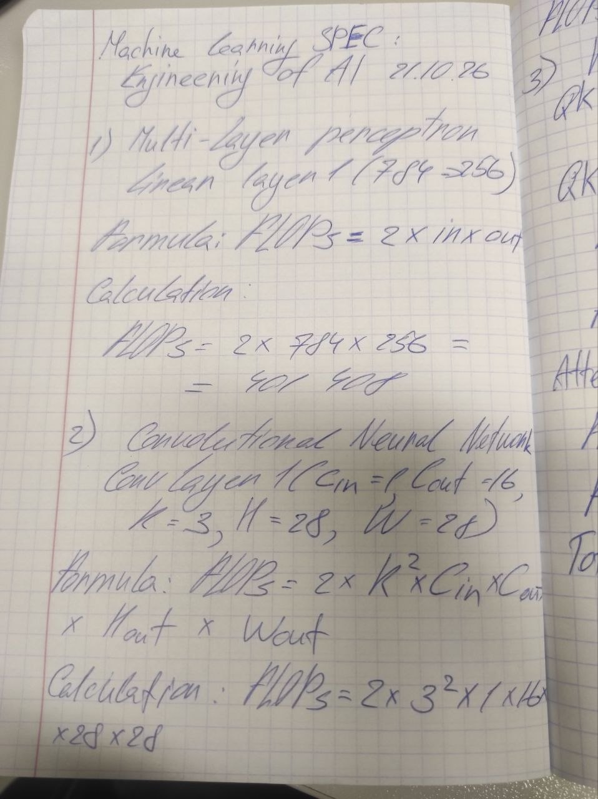
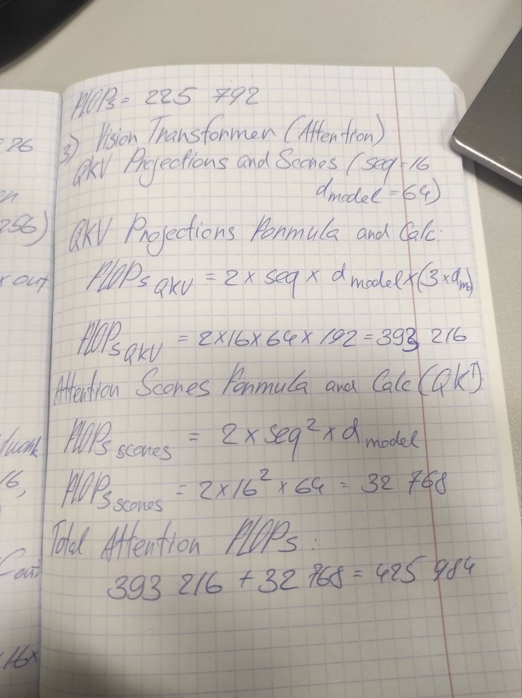

# Lab 3 Report: Architectures and Their Costs
## Hand-Calculated FLOPs (Written Notes)

## 1. Experimental Setup & Results Summary
* **Dataset**: Fashion-MNIST (55k train, 5k val, 10k test)
* **Optimizer**: Adam, lr=1e-3, 5 epochs, Batch size = 128[cite: 4]

| Model | Parameters | Hand-Calculated FLOPs | THOP Measured FLOPs (Batch 1) | Accuracy (%) | Latency (B=1, ms) | Latency (B=128, ms) |
| :--- | :--- | :--- | :--- | :--- | :--- | :--- |
| **MLP** | ~235k | 401,408 (Linear 1) | ~470k | ~87.3% | ~0.12 | ~9.02 |
| **CNN** | ~20k | 225,792 (Conv 1) | ~300k | ~89.5% | ~0.46 | ~4.08 |
| **Attention** | ~71k | 425,984 (QKV + Scores) | ~2.06M | ~1.20 | ~15.60 |

---

## 2. Hand-Calculated FLOPs (Ch. 4 Formulas)

1. **Linear Layer (MLP - Layer 1: $784 \to 256$):**
   * *Formula*: $\text{FLOPs} = 2 \times \text{in} \times \text{out}$[cite: 4]
   * *Calculation*: $2 \times 784 \times 256 = \mathbf{401,408 \text{ FLOPs}}$[cite: 4]

2. **Convolutional Layer (CNN - Conv 1: $C_{\text{in}}=1, C_{\text{out}}=16, K=3, H_{\text{out}}=28, W_{\text{out}}=28$):**
   * *Formula*: $\text{FLOPs} = 2 \times K \times K \times C_{\text{in}} \times C_{\text{out}} \times H_{\text{out}} \times W_{\text{out}}$[cite: 4]
   * *Calculation*: $2 \times 3 \times 3 \times 1 \times 16 \times 28 \times 28 = \mathbf{225,792 \text{ FLOPs}}$[cite: 4]

3. **Attention Layer (Transformer - $seq=16, d_{\text{model}}=64$):**
   * *Formula (QKV projections)*: $2 \times \text{seq} \times d_{\text{model}} \times 3 \times d_{\text{model}} = 2 \times 16 \times 64 \times 3 \times 64 = 393,216 \text{ FLOPs}$[cite: 4]
   * *Formula (Attention scores $QK^T$)*: $2 \times \text{seq}^2 \times d_{\text{model}} = 2 \times 16^2 \times 64 = 32,768 \text{ FLOPs}$[cite: 4]
   * *Total Attention FLOPs*: $393,216 + 32,768 = \mathbf{425,984 \text{ FLOPs}}$

---

## 3. Hand-Calculated vs Measured FLOPs Gap Analysis
* **Why gaps exist**:
  1. **Activation functions & Operations**: Hand calculations cover core MACs (Multiply-Accumulate) for linear/conv/projection weights, omitting non-linearities (ReLU), pooling layers, element-wise scaling, and Softmax.
  2. **Library Overhead & Framework Assumptions**: Profilers like `thop` capture the entire computational graph including tensor reshaping, transposition, broadcasting, and multi-head splitting.

---

## 4. Architectural Trade-offs & Memory Access Patterns (Ch. 4.6–4.7)

* **CNN (Most Cost-Effective)**:
  * **Inductive Bias**: Leverages spatial locality and translation invariance via weight sharing.
  * **Memory Access**: Highly efficient cache utilization and operational intensity on GPU, achieving high accuracy with minimal parameters (~20k).

* **MLP**:
  * **Memory Access**: Bound by memory bandwidth for 1D flattened inputs. Each parameter is fetched from DRAM for every sample without spatial weight reuse.

* **Attention / Vision Transformer**:
  * **Memory Access**: Exhibits quadratic complexity $O(N^2)$ with respect to sequence length. The generation of intermediate attention score matrices creates significant memory overhead, resulting in higher latency for small-scale image tasks.

**Conclusion**: **CNN** provides the optimal balance between accuracy, parameter efficiency, and compute cost for image classification tasks on Fashion-MNIST.